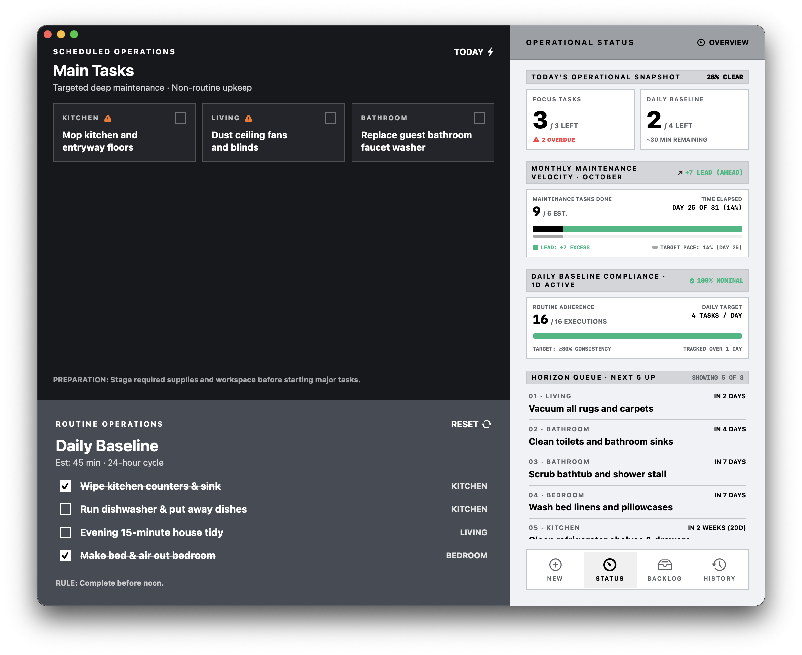

# ChoreDashboard


Deterministic macOS maintenance and routine tracking utility built on a Functional Core, Imperative Shell (FCIS) architecture.

**Target:** macOS 14.0+ | Swift 5.9

---

## Architecture & Systems

* **Functional Core (`Sources/Domain`)**: Pure Swift. Parameterized by an abstract `Clock` protocol with zero external/OS dependencies.
  * **Daily Baseline**: 24-hour cycle routines evaluated against active tracking days.
  * **Focus & Horizon**: Non-routine maintenance paced via dual-threshold velocity formulas (closed-day floor vs. today's ceiling).
  * **Runway Engine**: 5-tier status model (`GOOD`, `NOT YET`, `HALF`, `DUE`, `OVERDUE`) calculated from cadence intervals.
  * **Rollover**: Midnight state engine that purges completed one-time tasks and advances recurring schedules.
* **Storage Shell (`Sources/Storage`)**: Actor-isolated atomic JSON serialization with SHA-256 checksums and POSIX `DirectoryWatcher` for hot-reloading external file edits.
* **Presentation Shell (`Sources/Presentation`)**: SwiftUI/AppKit interface bound to an `@Observable` coordinator (`DashboardStore`) with isolated form draft state.

---

## State Persistence

All state is stored as a single, human-readable JSON file:
```text
~/Library/Application Support/ChoreDashboard/state.json
```
External modifications to this file automatically synchronize in real time.

---

## Commands

```bash
# Run development build
swift run ChoreDashboard

# Run test suite (Domain, Storage, Presentation, Regressions)
swift test

# Build and assemble standalone macOS release app (.app bundle in dist/)
./compile.sh
```